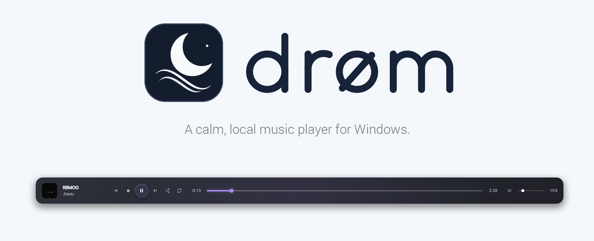
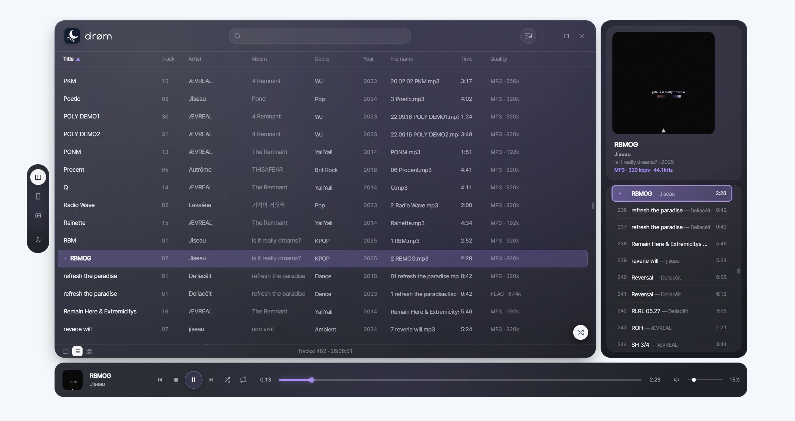
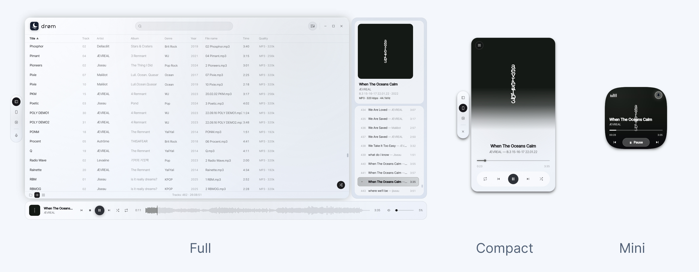
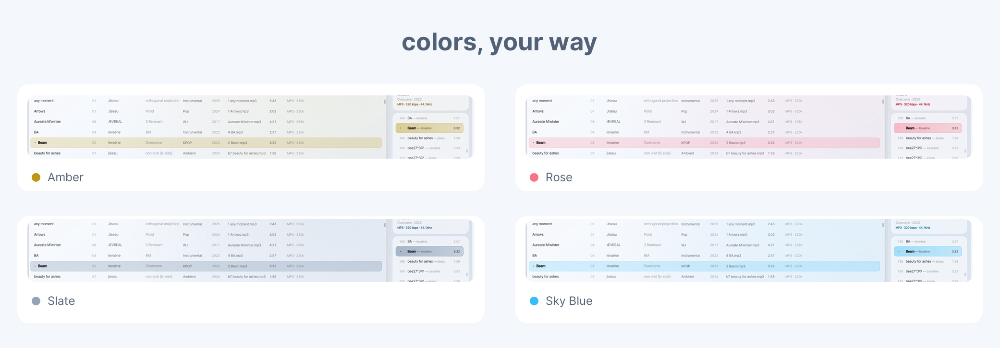
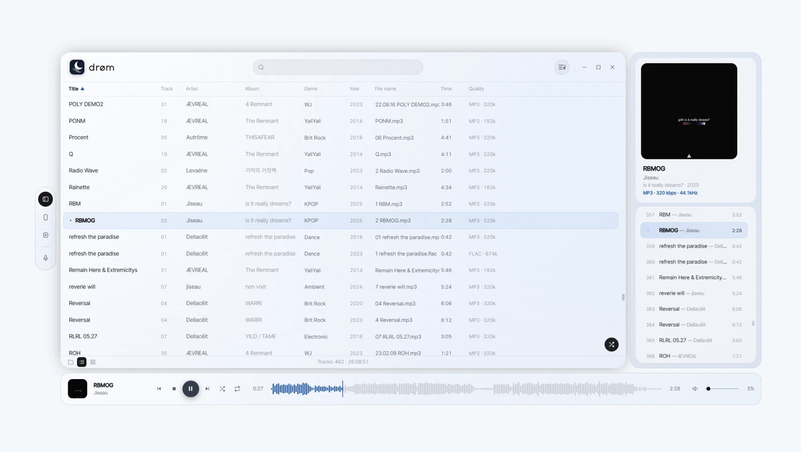
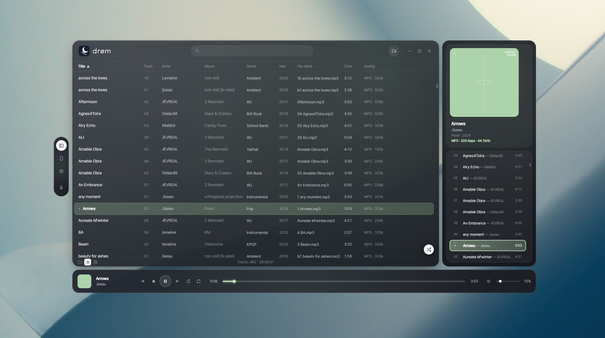
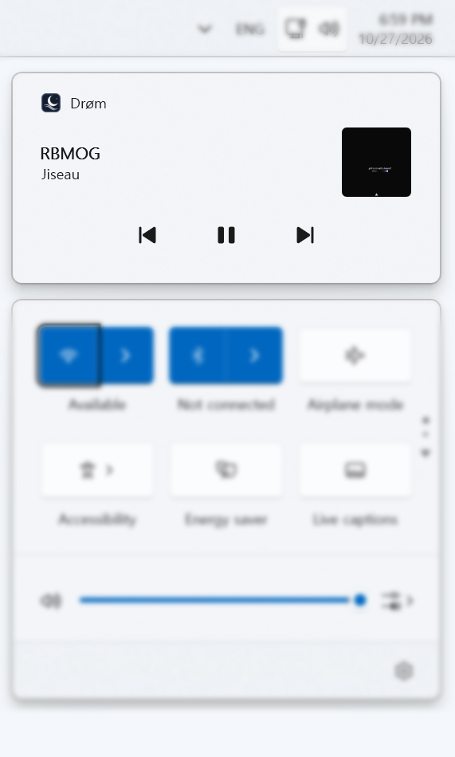
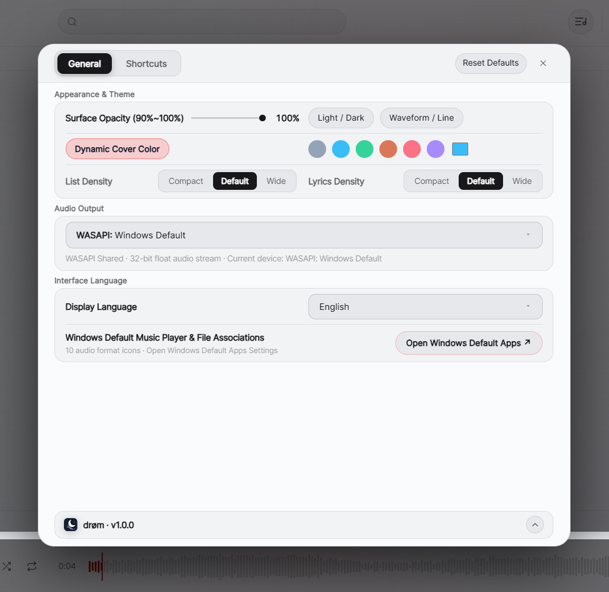

[Download](https://github.com/so1fr1d/droem/releases) · [Features](#features) · [Installation](#installation)

## Drøm

Drøm is a Windows music player for files stored on your computer. It brings a folder-based library, a separate playback queue and three window layouts into one interface.

  

## Window modes

**Full** shows the library and queue. **Compact** focuses on the current track. **Mini** keeps playback controls in a small, square window.

  

## Appearance

Switch between light and dark themes, choose an accent color, or enable **Dynamic Cover Color** to use colors from the current album artwork.

  

  
  

## Features

- **Left island:** floating controls beside the player.
- **Three window modes:** Full, Compact and Mini Squircle.
- **Themes:** light, dark, custom accents and album-reactive color.
- **10 audio formats:** MP3, FLAC, WAV, M4A, AAC, OGG, OPUS, WMA, AIF and AIFF.
- **Library and queue:** browse folders, manage the playback list and return to your library after opening external files.
- **Windows media controls (SMTC):** see track information and control playback from Windows.
- **21 interface languages:** manual selection or automatic system-language detection.

  

Settings screenshot

  

## Installation

Download `droem-setup-1.0.0.exe` from [Releases](https://github.com/so1fr1d/droem/releases) and run the installer.

- **Tested:** Windows 11 x64. Windows 10 x64 has not been tested on a physical machine for this release.
- **Runtime:** Microsoft Edge WebView2. The installer checks for it and may require internet access to install it if missing.
- **File associations:** Drøm does not change existing default audio-app selections. To assign file types, use **Windows Settings → Apps → Default apps**.

See [INSTALL_GUIDE.md](INSTALL_GUIDE.md) for details.

## Notes

- **Unsigned installer:** verify its SHA-256 using `SHA256SUMS.txt` from the release, and keep Windows security protections enabled.
- In Windows Settings, searching for `dro` may not find Drøm; searching for `drø` may work.
- The 21 interface languages passed automated translation-key checks, but not all have been reviewed by native speakers.
- Some WMA variants depend on available codecs. DRM-protected files may not play.

## Credits & licenses

Created by **so1fr1d**.

The interface was influenced by [AIMP](https://aimp.su/) and the AIMP custom skins **Mei** and **Wyn**. Drøm is an independent project and is not affiliated with AIMP or the skin creators.

Wallpaper in selected screenshots: [Johannes Plenio, *Gray and White Wallpaper* (Pexels)](https://www.pexels.com/photo/gray-and-white-wallpaper-1103970/).

Drøm is licensed under [MIT No Attribution (MIT-0)](LICENSE). See [third-party notices](THIRD_PARTY_NOTICES.md) and [third-party licenses](THIRD_PARTY_LICENSES.txt).
